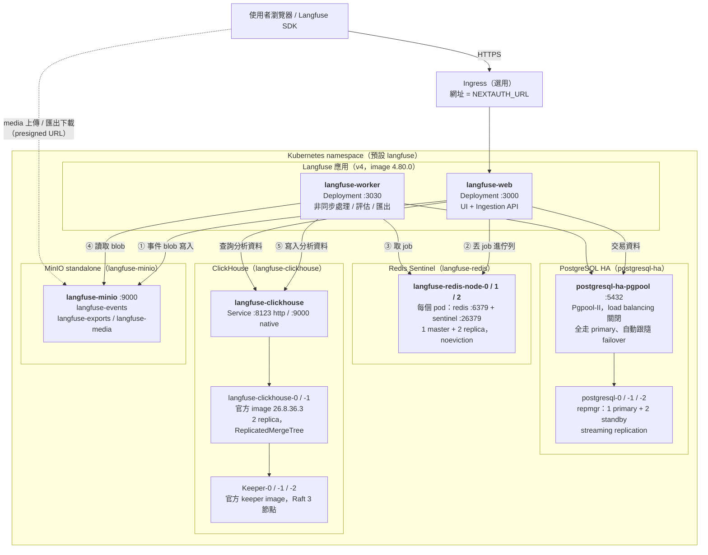
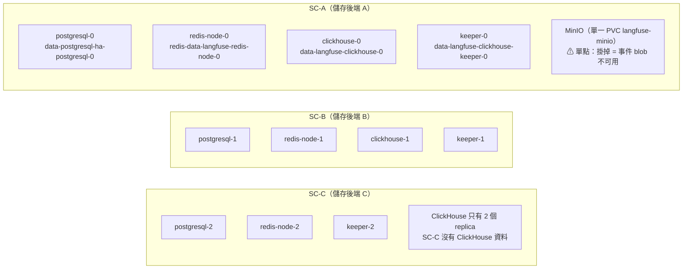
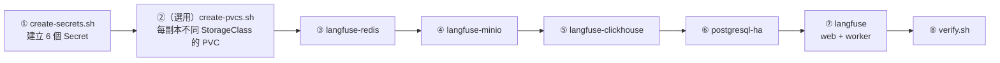

# 架構圖：Langfuse v4 on Kubernetes 元件關係（ClickHouse 使用官方 image 自建）

> 與 v3 版（`../langfuse-k8s`）的差別只有兩處：Langfuse 是 v4（4.80.0），以及 ClickHouse 改用官方 image 自建的 `charts/clickhouse-ha`（Pod 名稱 `langfuse-clickhouse-0/1`，不是 Bitnami 的 `shard0-N`）。其餘元件完全相同，所以不另附 PNG——Mermaid 在 GitHub / GitLab / VS Code 預覽都能渲染。

三張圖（Mermaid，GitHub / GitLab / VS Code 的 Markdown 預覽都能直接渲染）：

1. [執行期架構與資料流](#1-執行期架構與資料流)：誰連誰、走哪個 Service / port、資料怎麼流
2. [StorageClass 分散](#2-storageclass-分散每個副本放在不同的儲存後端)：3 個 StorageClass 各放哪些副本、掛掉一個會怎樣
3. [部署順序與 Secret 對應](#3-部署順序與-secret-對應)

## 1. 執行期架構與資料流

說明：

- **Langfuse 內部事件路徑**是 ①→②→③→④→⑤：web 收到 SDK 的事件後，先把原始事件 blob 寫進 MinIO、再把 job 放進 Redis；worker 從 Redis 取 job、讀 MinIO 的 blob、整理後寫進 ClickHouse。這就是 Redis 必須 `noeviction`（job 被 evict 就消失）、MinIO 掛掉會直接影響事件寫入的原因。
- **Postgres** 存「交易型」資料（使用者、組織、專案、API key、prompt、設定…），**ClickHouse** 存「分析型」大量資料（traces / observations / scores），兩邊 migration 都由 web 啟動時自動執行。
- 圖中**虛線 presigned URL**：Langfuse 的 media 上傳與批次匯出下載是發 presigned URL 讓使用者的瀏覽器 / SDK 直接連 S3，所以 `s3.mediaUpload.endpoint`、`s3.batchExport.endpoint` 若是叢集內部位址（預設 `http://langfuse-minio:9000`），對叢集外的使用者不會通；事件寫入（①④）是叢集內部自己連，沒問題。這點**沒有在本專案實測過**，部署後請用實際的 SDK media 上傳與匯出各試一次；要對外就得替 MinIO 開一個對外的 Ingress/網址並覆寫這兩個 endpoint。
- 所有連線都用同 namespace 的短名稱（`postgresql-ha-pgpool`、`langfuse-redis-node-N.langfuse-redis-headless`、`langfuse-clickhouse`、`langfuse-minio`），所以 Langfuse 與各元件要在同一個 namespace。

## 2. StorageClass 分散：每個副本放在不同的儲存後端

公司 k8s 有 3 個 StorageClass（下圖記為 SC-A / SC-B / SC-C）。每個 HA 元件的副本依序落在不同的 class；實作方式是 `scripts/create-pvcs.sh` 在 helm 安裝前預先建好每個副本的 PVC（見 README「StorageClass 分散」）。

| 元件 | 副本 → StorageClass（序號 i → 第 i mod 3 個 class） | 某個 StorageClass 整個壞掉時 |
|---|---|---|
| PostgreSQL（3） | 0→A、1→B、2→C | repmgr 自動 failover 到存活的 standby；Pgpool 自動跟隨，Langfuse 不需動作 |
| Redis Sentinel（3） | 0→A、1→B、2→C | Sentinel 在存活節點間重新選 master（quorum 2，剩 2 個仍可選） |
| ClickHouse（2，官方 image 自建） | 0→A、1→B | 另一個 replica 仍可讀寫（ReplicatedMergeTree）；壞掉的那個修復後自動補資料。**只有 2 個 replica，同時壞 2 個 class 就沒有了** |
| ClickHouse Keeper（3） | 0→A、1→B、2→C | 剩 2/3 仍有 Raft quorum，ClickHouse 可正常寫入 |
| MinIO（1） | 只能放 1 個 class（預設 SC-A） | **事件 blob 不可用，Langfuse 寫入受影響。** 建議改接叢集既有的 S3，或把 `MINIO_STORAGE_CLASS` 指到最可靠的那個 class |

注意：

- StorageClass 分開只保證**資料不會同時在同一個儲存後端**；pod 要不要分散在不同 node，還是靠 anti-affinity（≥3 個 node 時請設 `hard`，見 README「正式環境調整」）。
- 如果這 3 個 StorageClass 對應不同可用區（volumeBindingMode 是 `WaitForFirstConsumer`，且 PV 有 zone 限制），pod 會被排到 PVC 所在的 zone，等於同時達成跨 zone；若是 `Immediate`，PV 先建好之後 pod 必須追著 PV 的 zone 走，請確認每個 zone 都有可排程的節點。
- 容量變動／PVC 被刪除後由 StatefulSet 依 template 重建時，會落在 `STORAGE_CLASSES` 的第一個 class（不一定是原來的），所以刪 PVC 之前請先確認；這時要靠 `./scripts/verify.sh storage` 檢查分散是否被破壞。

## 3. 部署順序與 Secret 對應

| Secret | key | 使用者 |
|---|---|---|
| `langfuse-redis-auth` | `redis-password` | redis chart（Redis 與 Sentinel 共用）、langfuse |
| `langfuse-minio-auth` | `root-user` `root-password` | minio chart、langfuse（當 S3 access key / secret） |
| `langfuse-clickhouse-auth` | `admin-password` | clickhouse chart、langfuse |
| `langfuse-postgresql-auth` | `postgres-password` `password` `repmgr-password` | postgresql-ha chart（`password` 是 `langfuse` 使用者的密碼，langfuse 也讀這個） |
| `langfuse-pgpool-auth` | `admin-password` `sr-check-password` | postgresql-ha chart（Pgpool 內部） |
| `langfuse-app-secrets` | `salt` `encryption-key` `nextauth-secret` | langfuse（遺失 salt / encryption-key 無法復原，請備份） |

Langfuse 啟動時，web 先對 Postgres（Prisma）與 ClickHouse（golang-migrate）各跑一次 schema migration（v4 會建立 `events_full` / `events_core` 等新表，含全文檢索索引），成功後才開始服務。
