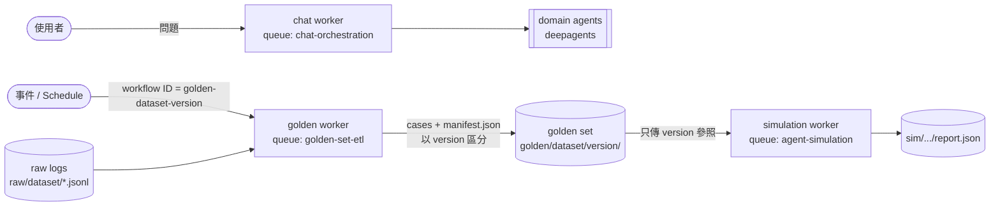

# Temporal 多 workflow 隔離範例

示範如何在同一套 Temporal（Server + UI 共用）上，讓三種性質不同的 workflow **互不影響**：

| # | Workflow | Task Queue | 性質 | 範例重點 |
|---|---|---|---|---|
| 1 | `ChatOrchestrationWorkflow` | `chat-orchestration` | 低延遲、與使用者互動 | 路由 → 平行呼叫 domain agent → summary；短 timeout、少重試 |
| 2 | `GoldenSetWorkflow` | `golden-set-etl` | 批次、事件觸發、可 re-run | fan-out（限並行）、Continue-As-New、heartbeat、冪等 activity、冪等觸發 |
| 3 | `SimulationWorkflow` | `agent-simulation` | 批次、大量 LLM 呼叫 | 只吃 golden set「版本參照」、non-retryable 錯誤、獨立輸出路徑 |

所有 LLM / deep agent 呼叫都用 `common/mock_agents.py` 的假實作取代，所以**不需要任何 API key 或模型**。每個 mock 的位置都有註解寫明正式專案要換成什麼。

## 資料流



- **Workflow / Activity 之間只傳參照（key），不傳資料。** 資料在 `storage.py`（本機資料夾，模擬 MinIO / S3）。這樣不會碰到 Temporal 的 payload（約 2MB）與 Event History 大小限制。
- (3) **不是** (2) 的 child workflow：兩者生命週期不同，同一版 golden set 也可能被不同 agent 版本重複模擬。

## 目錄

```
isolation-demo/
├── common/            共用：models、storage（模擬 object storage）、mock_agents、names（queue 名稱）
├── chat/              (1) workflow + activities
├── golden/            (2) workflow + activities
├── simulation/        (3) workflow + activities
├── worker.py          單一入口，三種角色：python worker.py chat|golden|simulation
├── client.py          觸發三種 workflow
├── seed_data.py       產生假的 raw logs（含重複、壞評價、email/手機）
├── tests/             workflow 測試（Temporal 測試用 server）
├── Dockerfile         同一個 image，用 WORKER_ROLE 決定角色
└── k8s/workers.yaml   三個 Deployment（chat 含 HPA + PDB）
```

## 在本機跑

這個資料夾上層（`temporal-example/`）已有 `docker-compose.yml`，沿用它的 Temporal Server（`localhost:7233`）。

```bash
cd temporal-example && docker compose up -d      # 已經在跑就略過
cd isolation-demo
python3 -m venv .venv && source .venv/bin/activate
pip install -r requirements.txt
```

開三個 terminal（各自 `source .venv/bin/activate`），各跑一個角色：

```bash
python worker.py chat
python worker.py golden
python worker.py simulation
```

再開第四個 terminal 觸發：

```bash
# (1) 對話
python client.py chat "Refund my invoice and reset my password"

# (2) 產生 golden set
python seed_data.py                                   # 7 個 raw batch -> ./data/raw/demo/
python client.py golden --dataset demo --version v1

# (3) 用 mock agent 對同一版 golden set 做模擬
python client.py simulate --golden-version v1 --variant mock-good
python client.py simulate --golden-version v1 --variant mock-flaky   # 故意會錯一部分
```

> 上層 `docker-compose.yml` 的 UI 開了 `TEMPORAL_AUTH_ENABLED`（GitLab OIDC）；如果登入設定還沒填好，UI 可能進不去，但不影響 worker / client 透過 7233 連線。

到 Temporal UI 看 `golden-demo-v1`：同一個 Workflow ID 底下會有 **3 個 Run**（前兩個以 Continue-As-New 結束，第三個寫 manifest）。

## 各個設計在哪裡

### (1) 保護延遲
- 獨立 queue + 獨立 Deployment：`k8s/workers.yaml` 的 `temporal-worker-chat`，memory request == limit、HPA、PDB。
- `chat/workflows.py`：短 timeout、`maximum_attempts=3`，寧可快速失敗。
- **Worker 隔離不會隔離 LiteLLM / vLLM。** 批次流量仍可能吃光模型吞吐，所以 golden / simulation 用各自的 LiteLLM virtual key（yaml 內的 `litellm-batch-key`、`litellm-sim-key`），並在 LiteLLM 端設 rate limit / 預算。

### (2) 大量、事件觸發、可 re-run
- **冪等觸發**：Workflow ID = `golden-{dataset}-{version}`，`client.py` 用 `ALLOW_DUPLICATE_FAILED_ONLY`。同一個事件送兩次，第二次會被擋下（成功或執行中的不會重複啟動）。
- **Fan-out 限並行**：每 `MAX_PARALLEL` 個 batch 一組 `asyncio.gather`，每個 batch 各自重試。
- **Continue-As-New**：每處理 `BATCHES_PER_RUN` 個 batch 就帶著 `offset` 續跑，Event History 不會無限成長。Demo 用 4，正式環境要遠小於 Temporal 的 history 上限（硬上限 51,200 events / 50MB，建議在約 10k events 前就續跑）。
- **Heartbeat**：`clean_batch` 每 50 筆 heartbeat，搭配 `heartbeat_timeout`，worker 掛掉時能很快重派。
- **冪等 activity**：輸出路徑由輸入決定（`golden/{dataset}/{version}/cases/{batch_id}.json`），寫入是 atomic。重跑時已存在的會跳過（`force=True` 才覆寫）。

### re-run 的兩種情境

| 情境 | 做法 |
|---|---|
| 邏輯或參數改了，要整批重做 | `python client.py golden --version v1 --rerun 2 --force`（新的 Workflow ID，覆寫輸出），或直接用新的 `--version v2`（保留舊版給 (3) 比對） |
| 跑到一半失敗，從失敗處繼續 | 對同一個 Workflow 做 **Reset**（保留已完成的 activity）。用 Temporal CLI：`temporal workflow reset --workflow-id golden-demo-v1 ...`，實際參數請用 `temporal workflow reset --help` 對照你們 CLI 的版本 |

> 失敗的 workflow 也可以直接再 `python client.py golden ...` 啟動一次：`ALLOW_DUPLICATE_FAILED_ONLY` 允許失敗的 ID 重用，而已完成的 batch 會因冪等被跳過。

### (3) 模擬測試
- 輸入只有 `golden_version`，不帶資料；找不到 golden set 時用 `ApplicationError(non_retryable=True)` 立即失敗，不會白白重試。
- 輸出路徑含 `run_id`（= workflow ID），同一版 golden set 可以被不同 agent 版本重複模擬而不互相覆蓋。
- 正式專案：mock agent 必須搭配 **mock tools**（無副作用），不要接真實外部系統。

## 測試

```bash
pip install -r requirements.txt
pytest -q tests
```

`WorkflowEnvironment.start_time_skipping()` **第一次執行會自動下載 Temporal 測試 server**，所以需要能連外。測試涵蓋：Continue-As-New 與冪等、重複觸發被擋、good vs flaky 模擬、golden set 不存在時快速失敗。

### 驗證狀態（誠實交代）
建立這個範例時的環境無法下載測試 server，所以 **`tests/` 裡的 workflow 層級測試我沒有實際跑過**，請你在本機跑一次。已經確認的部分：
- 所有檔案可編譯；三個 workflow 的定義都能被 Temporal Python SDK 載入（sandbox 驗證）。
- 把 activity 依 workflow 的順序直接呼叫一遍：7 個 batch → 2 次 Continue-As-New 視窗 → manifest 76 個 case；重跑全部跳過且結果一致；PII 已遮罩、batch 內無重複；`mock-good` 通過率 100%、`mock-flaky` 約 81.6%；golden set 不存在時為 non-retryable 錯誤。

## 刻意簡化的地方
- storage 用本機資料夾；k8s 上多個 Pod 要共用資料時改成 S3 / MinIO（`common/storage.py` 是唯一要改的檔案），`k8s/workers.yaml` 的 `DEMO_DATA_DIR` 只是占位。
- `list_log_batches` 用 offset 分頁；正式環境要在流程開始時固定 snapshot / 截止時間。
- 去重只在單一 batch 內；跨 batch 去重要另外加一個步驟（例如在 manifest 階段依 case id 去重）。
- 沒有 Worker Versioning。改動既有 workflow 邏輯時要另外用 `workflow.patched()` 或 Worker Versioning 處理執行中的 workflow。
- Namespace 共用 `default`。若 (2)(3) 的 history retention 與 (1) 不同，再把它們搬到獨立 namespace。
